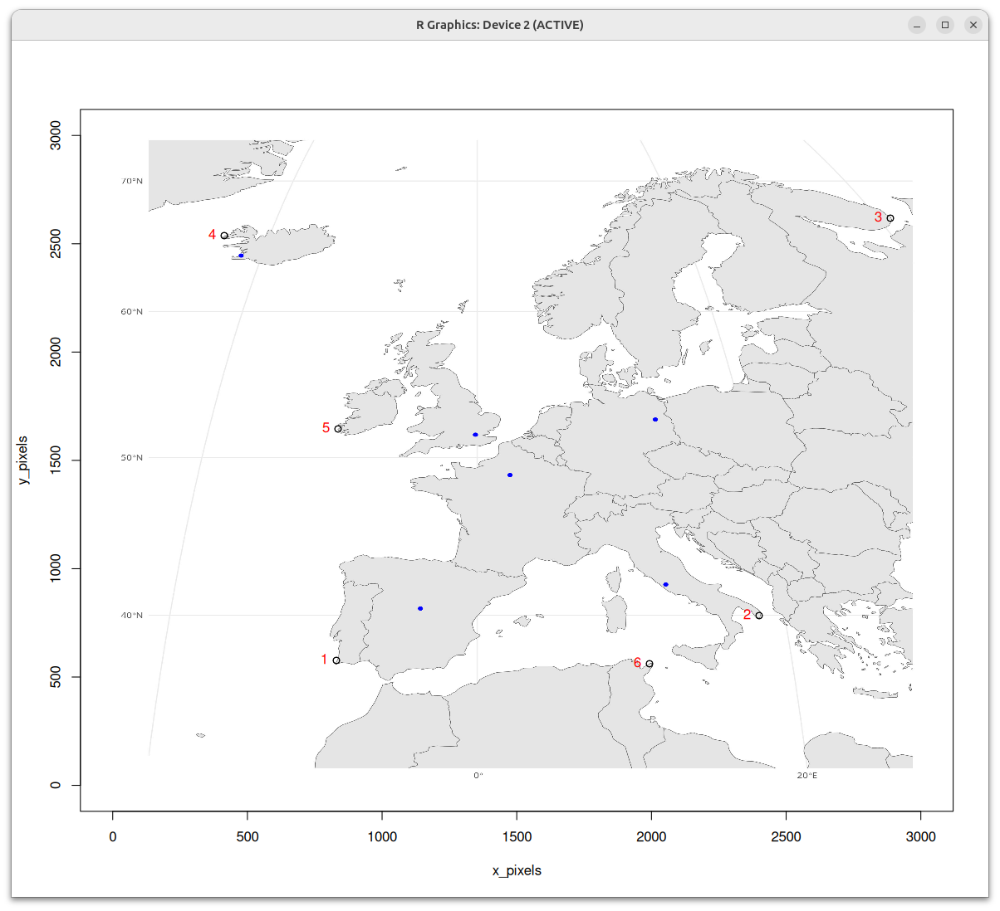
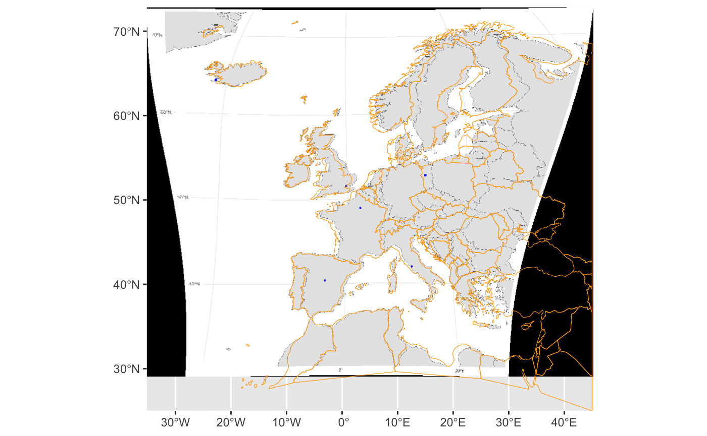
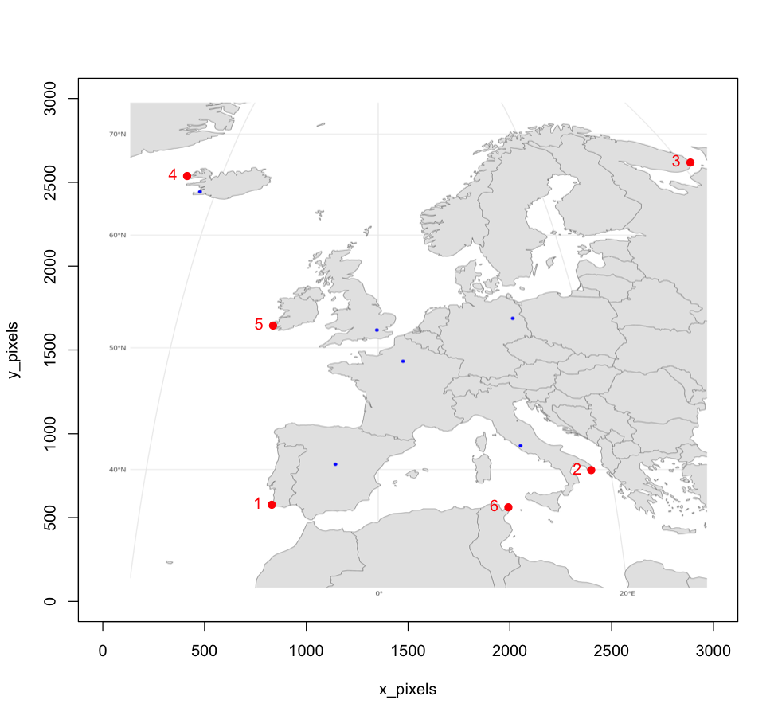
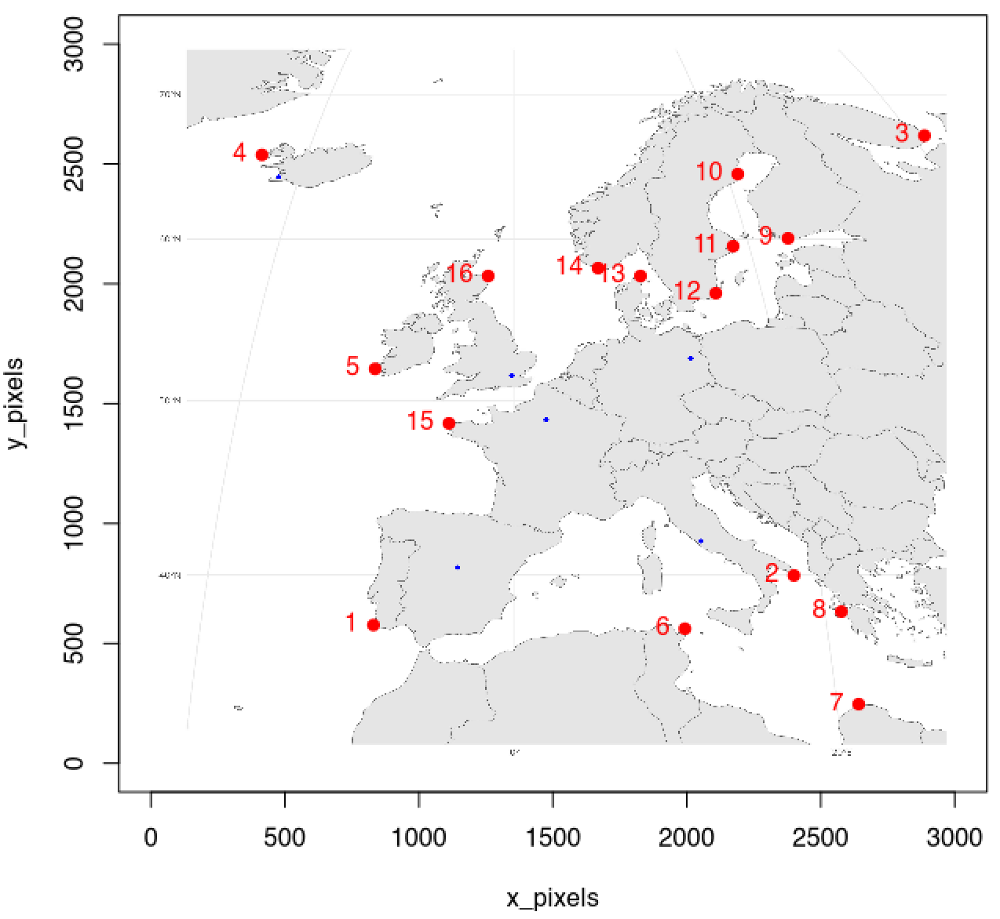
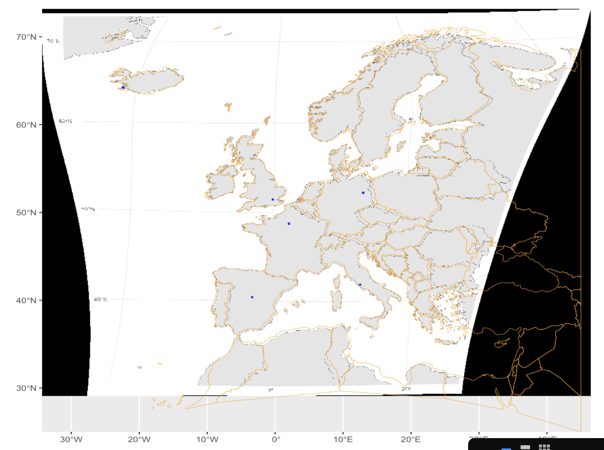

```{r, include = FALSE}
knitr::opts_chunk$set(
  collapse = TRUE,
  comment = "#>"
)
```

Georeferencing is the process of assigning real-world coordinates to an image,
allowing it to be accurately placed on a map. This is often done using Ground
Control Points (GCPs), which are known locations on the ground with precise
coordinates. In this vignette, we will demonstrate how to georeference an
image using GCPs in the `crstools` package.

The process of assigning GCPs to an image is interactive, allowing you to
select points on the image and assign them geographic coordinates.
Unfortunately, this is not compatible with Rmarkdown or the image pane within
RStudio.`crstools` opens separate windows for GCP assignment and image display,
and the code has to be run from a script or the console.

To get started, we need to load the `crstools` package:

```{r setup}
library(crstools)
```

Next we need a .jpg image that we scanned or downloaded. We will use a map of
Europe that is included with the package. The map has a number of points (the
capitals of UK, France, Spain, Germany, Italy, and Iceland). 

Our task is to georeference this image and then extract the coordinates
of those capitals. We will copy a version of the image to a temporary directory,
and work on that:

```{r image_path}
file.copy(
  from = system.file("extdata/europe_map.jpeg", package = "crstools"),
  to = tempdir(),
  overwrite = TRUE
)

img_path <- file.path(tempdir(), "europe_map.jpeg")
```

We can now select a number of GCPs with `choose_gcp()`. This function allows
you to click on the image and assign coordinates to the points you select.
Choose locations that are easy to find again on a map, such as features in
coastlines (e.g. bays), or corners of country boundaries.
```{r choose_gcp, eval = FALSE}
gcp_europe <- choose_gcp(img_path)
```

This will open a window showing the image:

{width=500px}

You can click on the image to select points by left-clicking with your mouse.
The points will be numbered in the order in which they were chosen; you can
stop by pressing the ESC key, or with a right-click.

{width=500px}

```{r save_gcp1, echo = FALSE, eval= FALSE}
# Run me to save the object if you are recreating the vignette
saveRDS(gcp_europe, "./vignettes/img/europe_gcp1.RDS")
```

```{r load_gcp1, echo = FALSE, results = "hide"}
gcp_europe <- readRDS("./img/europe_gcp1.RDS")
```

The coordinates of those points will be
saved in the `gcp_europe` dataframe, which contains the following columns:
```{r gcp_europe_1}
gcp_europe
```

Next we need to get the coordinates (longitude and latitude) of these points.
We can use the `find_gcp_coords()` function to assign geographic coordinates to
the GCPs. This function requires a reference map in the form of an `sf` object.
We will use the `rnaturalearth` package to get a map of Europe, and then crop
it to the extent of the image.
```{r get_coords_1}
library(sf)
library(rnaturalearth)
# Load the world map
world <- ne_countries(scale = "medium", returnclass = "sf")
# Transform it to a suitable projection
world <- st_transform(world, crs = 4326) # WGS 84
# Crop it to the extent of the image to Europe
europe <- st_crop(world, c(xmin = -25, ymin = 25, xmax = 45, ymax = 70))
```

Let's quickly plot it to check that we have the correct extent:
```{r plot_europe_1, eval = FALSE}
library(ggplot2)
ggplot() +
  geom_sf(data = europe, fill = "lightblue", color = "black") +
  coord_sf(expand = FALSE) +
  ggtitle("Map of Europe")
```
Now we can use the `find_gcp_coords()` function to assign geographic
coordinates to the GCPs.

{width=500px}

```{r find_gcp_coords_1, eval = FALSE}
gcp_europe_coords <- find_gcp_coords(gcp_europe, europe)
```

This will open a new window with the map of Europe, and you can click on the
points to assign coordinates to the GCPs.
```{r save_gcp2, echo = FALSE, eval= FALSE}
# Run me to save the object if you are recreating the vignette
saveRDS(gcp_europe_coords, "./vignettes/img/europe_gcp_georef.RDS")
```

```{r load_gcp2, echo = FALSE, results = "hide"}
gcp_europe_coords <- readRDS("./img/europe_gcp_georef.RDS")
```

Now the `gcp_europe_coords` dataframe contains the geographic coordinates of
the GCPs:
```{r gcp_europe_coords_1}
gcp_europe_coords
```

Finally, we can use the `georeference_img()` function to georeference the image
using the GCPs. This fucntion has an `tranform_method` argument that sets 
how pixel coordinates are mapped onto the geographic ones. The best choice
depends on the type of map that we want to georeference and the number of 
GCPs that we have: 

- `"poly_1"` (>= 3 GCPs): first order polynomial transformation, shifts, scales, 
and rotate the image without bending it. This type of transformation is suitable 
for maps that are in a lon/lat projection or that cover a small area.
- `"poly_2"` (>= 6 GCPs): second order polynomial transformation, allows for
bending of the image, thus being more suitable for maps in other projections.
- `"poly_3"` (>= 10 GCPs): third order polynomial transformation, allows for 
capturing of more complex distortions than the other two methods, but it is
more sensitive to errors in the GCPs.
- `"tps"`: thin plate spline transformation, allows for local corrections, thus
being more suitable for maps characterised by artefacts, such as scanned maps,
but requires many accurate, well spread GCPs, since any wrong GCP can lead to
strong distortion biases. 
- `"auto"`: automatically `"poly_1"` or  `"poly_2"` transformation based on
the number of GCPs provided.

It is important to highlight that, higher order polynomial transformations
are not always the best choice. These are more sensitive to errors in the GCPs,
and can lead to distortions in areas where there are no GCPs. High order
polynomial transformations should be chosen when we have many accurate GCPs,
well spread across the image.
For maps taken directly from publications or other digital sources, like in our
case, a first- or second-order polynomial transformation is usually sufficient:
```{r georeference_image_1}
georeferenced_image <- georeference_img(img_path, gcp_europe_coords, 
                                        transform_method = "auto")
```

The `georeference_img()`function will create a new TIFF file with the
georeferenced image. The output file will have the same name as the input image,
but with the suffix `_warp.tif` added to it.

The georeferenced image can be loaded into R using the `terra` package as a
SpatRaster:
```{r load_georeferenced_image_1}
map_warp <- terra::rast(georeferenced_image)
```

We can now plot the georeferenced image to check the overlap between the input
image and the georeferenced image. This can inform us if more points (GCPs)
need to be added and previous steps repeated (`choose_gcp()`).
```{r plot_warped_image_1, eval=FALSE}
library(ggplot2)
library(tidyterra)
ggplot() +
  geom_spatraster_rgb(data = map_warp) +
  geom_sf(
    data = europe,
    color = "orange",
    fill = "transparent"
  ) +
  coord_sf(expand = FALSE)
```

{width=500px}

We can see that the georeferenced image is not perfectly aligned with the
reference map, especially in the eastern part of Europe.
This is likely due to geographically uneven distribution of the GCPs, which
can lead to inaccuracies in the georeferencing process.

We can visually check the distribution of the GCPs that we have previously
selected. To do so, we can plot the GCPs on the map of Europe to visualize their
distribution:
```{r check_gcp_distribution_1, eval=FALSE}
plot_gcp(img_path, gcp = gcp_europe)
```
{width=500px}

We can see that there most of the GCPs are clustered in the western part of
Europe, with only one GCP (3) in the eastern part. This is likely to be the 
driver of the misalignment of the georeferenced image.

Rather than just visually assessing the distribution of our GCPs, we can also 
assess their "quality" by looking at their residuals, using the same
transformation method that `georeference_img()` applied to the image:
```{r get_residuals_1}
gcp_residuals <- get_gcp_residuals(gcp_europe_coords,
                                   transform_method = "auto")

gcp_residuals[, c("id", "res_km", "leverage", "loo_km")]
```

This function returns the residual of the GCPs (`"res_km"`), which is the
distance between where we placed the GCP and where the transfomartion actually
puts it. A GCP with much larger residual that the others is likely to be
misplaced. However, residuals can be optimistic, since each GCP is used to fit
the transformation it is compared against. This is particularly true for GCPs
with high `leverage` values (ranging from 0 to 1), which indicate isolated GCPs
that pull the transformation towards them. The leave-one-out residuals (LOO)
(`"loo_km"`) solve this issue by measurin the error of each GCP when it is not
used to fit the transformation.

However, when teh number of the GCPs equals the minimum required by the chosen
tyransormation method, like in our case (6 GCPs for a second-order polynomial
transformation), the transformation passes through all the GCPs, so all
residuals are zero and the leverages are 1. LOO residuals are instead all `NA`, 
as removing any GCP leaves us with too few GCPs to fit the transformation. This 
indicates that more GCPs are needed to assesse the error. 

For these reasons, we may want to add more GCPs and spread them all across the
image. To add more points to improve the fit, we use: 
```{r choose_gcp_version_2, eval = FALSE}
gcp_europe <- choose_gcp(img_path, gcp = gcp_europe)
```

```{r save_gcp2_update, echo = FALSE, eval= FALSE}
# Run me to save the object if you are recreating the vignette
saveRDS(gcp_europe, "./img/europe_gcp2.RDS")
```

```{r load_gcp2_update, echo = FALSE, results = "hide"}
# Reload if needed
gcp_europe <- readRDS("./img/europe_gcp2.RDS")
```

Additional points were added to the `gcp_europe` dataframe:
```{r gcp_europe_2}
gcp_europe
```

We can now visualise the new distribution of the GCPs on the map of Europe:
```{r check_gcp_distribution_2, eval=FALSE}
plot_gcp(img_path, gcp = gcp_europe)
```
{width=500px}

Now we can repeat the process of assigning coordinates to the GCPs using `find_gcp_coords()` and `georeference_img()`:
```{r find_gcp_coords_version_2, eval = FALSE}
gcp_europe_coords_v2 <- find_gcp_coords(gcp_europe, europe)

gcp_europe_coords_v2
```

Run the following code chunk to save the object if you are recreating the vignette
```{r save_gcp2_2, echo = FALSE, eval= FALSE}
saveRDS(gcp_europe_coords_v2, "./img/europe_gcp_georef_v2.RDS")
```

```{r load_gcp2_2, echo = FALSE, results = "hide"}
gcp_europe_coords_v2 <- readRDS("./img/europe_gcp_georef_v2.RDS")
```

Repeat georeferencing of the image using the GCPs
```{r georeference_image_2, eval=FALSE}
georeferenced_image_v2 <- georeference_img(img_path, gcp_europe_coords_v2,
                                           transform_method = "auto")

map_warp_v2 <- terra::rast(georeferenced_image_v2)

# check the new image
ggplot() +
  geom_spatraster_rgb(data = map_warp_v2) +
  geom_sf(
    data = europe,
    color = "orange",
    fill = "transparent"
  ) +
  coord_sf(expand = FALSE)
```
{width=500px}

We can see that the additional points improved the georeferencing of the image, 
as the map now aligns better with the geographic coordinates of the GCPs.

We can also quantify the improvement by looking at the residuals of the GCPs:
```{r get_residuals_2}
gcp_residuals_v2 <- get_gcp_residuals(gcp_europe_coords_v2,
                                   transform_method = "auto")

gcp_residuals_v2[, c("id", "res_km", "leverage", "loo_km")]
```

As we can see, because we have more GCPs than the minimum required, we can now
calculate the residuals, which we can summarise into an overall
error, the root mean square error (RMSE):
```{r get_rmse}
sqrt(mean(gcp_residuals_v2$res_km^2))
sqrt(mean(gcp_residuals_v2$loo_km^2, na.rm = TRUE))
```

The RMSE tells us that, on average, our GCPs are approxiametely 42 Km away from
where the transformation places them, while the LKOO RSEM is about three times
larger. This gap indicates thta the error is thefore larger in parts of the map
that are far way from any GCPs. 
When we look at the residuals of each GCP, we can see that this is mostly driven
by the GCPs placed at the edge of the map, such as GCP1 (Portugal),
GCP4 (Iceland), and GCP3 (Russia), which have highe leverages and residuals
much larger than the rest of the GCPs. This indicates that we may need to 
add more GCPs in these areas to improve the georeferencing of the image.

However, choosing if this magnitude of error is acceptable or not depends on
what we want to do with the georeferenced image. If we need to extract data for
analyses at large geographic scale, such as mapping the distribution of species
across Europe, this level of error may be acceptable. On the other hand, more
GCPs may be needed if we want to extract data at a finer scale with reduced
error. 

Assuming we are fine we this error, we now use locator to get the coordinates
of the blue dots: 
```{r get_coords_2, eval = FALSE}
# get the coordinates of the blues points
blue_coords_df <- extract_coords(map_warp_v2)
```

```{r save_blue_coords, echo = FALSE, eval= FALSE}
saveRDS(blue_coords_df, "./img/blue_coords.RDS")
```

```{r load_blue_coords, echo = FALSE, results = "hide"}
blue_coords_df <- readRDS("./img/blue_coords.RDS")
```

So we now have the coordinates of the blue dots:
```{r show_blue_coords}
blue_coords_df
```

There are only 5 entries - we forgot one of the dots, let's re run the function:
```{r get_coords_3, eval = FALSE}
blue_coords_df <- extract_coords(map_warp_v2, blue_coords_df)
```

```{r save_blue_coords_2, echo = FALSE, eval= FALSE}
saveRDS(blue_coords_df, "./img/blue_coords_2.RDS")
```

```{r load_blue_coords_2, echo = FALSE, results = "hide"}
blue_coords_df <- readRDS("./img/blue_coords_2.RDS")
```

So we now we can see check that all the blue dots have been recorded:
```{r show_blue_coords2}
blue_coords_df
```

Starting from a non georeferenced image, we were then able to extract the 
coordinates of our locations of interest. 

